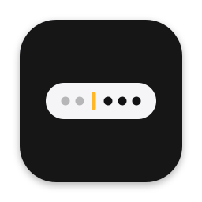

<p align="center">
  
</p>

<h1 align="center">peekaboo</h1>

<p align="center">A tidier menu bar for macOS 27. Icons you don't need right now stay out of sight until you want them.</p>

## What it does

- **Tucks icons away.** A small divider sits in your menu bar. Anything to its left hides, and anything to its right stays put. Click the divider to peek at the hidden ones.
- **Works around the notch.** If your icons get lost behind the notch, peekaboo can show the hidden ones in a little bar just below the menu bar instead. Their icons stay live, so things like CPU meters keep updating.
- **Hides itself again.** Turn on auto-hide and revealed icons tuck themselves away after a delay you pick, from instantly to 10 seconds. It waits while you're using them.
- **Quiets the app menus.** File, Edit, View and friends stay hidden until you hover the menu bar. The Apple logo and app name always stay.

## Getting started

peekaboo isn't from the App Store or notarized by Apple, so macOS asks you to OK it the first time.

1. Unzip it and drag `peekaboo.app` into your **Applications** folder. It needs to live there, because macOS hides the divider for apps run from anywhere else.
2. Open it. If macOS blocks it, go to **System Settings > Privacy & Security** and click **Open Anyway**.
3. Allow **Accessibility** when asked. That's how peekaboo sees where your icons are.
4. Using the second bar? Allow **Screen Recording** the first time you open it, then reopen peekaboo. peekaboo only ever looks at the menu bar, when it launches and while the second bar is open. Without the permission, the second bar shows app icons instead.

## Using it

- **Choose what hides:** hold ⌘ and drag icons left of the divider to hide them, or right of it to keep them visible.
- **Show or hide:** click the divider.
- **Settings:** right-click the divider and pick **Settings…**. If the divider ever goes missing, open peekaboo again from Applications and Settings comes up.
- **Make it yours:** in Settings you can pick the divider's look (chevron, dot, diamond or line), choose the menu bar or the second bar for hidden icons, turn on auto-hide, and launch peekaboo at login.

## Good to know

A few quirks come from how macOS 27 works:

- **Apps hide as a whole.** If an app has several icons, they hide or show together.
- **Some icons always stay.** Apple's own icons, like the clock, Wi-Fi and Control Center, are always visible.
- **The recording dot.** The second bar takes a fresh look at your icons about once a second while it's open, so the screen recording dot stays on until you close it.
- **Icons that don't fit.** If there's no room for an icon even in the menu bar, the second bar shows that app's icon instead.
- **App menu hiding is a macOS setting.** It's one Apple hasn't documented, and peekaboo just switches it on. It stays on after you quit peekaboo, so turn it off in Settings first if you want your menus back for good.
- **Updates can break things.** peekaboo relies on parts of macOS that Apple doesn't officially support, so a macOS update could break hiding. If that happens, all your icons simply stay visible.

## Something not working?

- **Permissions acting up?** Open Settings, then choose **Help > Reset All Permissions…** from the menu bar. peekaboo forgets its access, reopens and asks again.
- **Divider gone?** Open peekaboo again from Applications to bring it back.

## Building it yourself

```sh
scripts/package.sh
```

This builds `build/peekaboo.zip`, signed with your Apple Development certificate.
